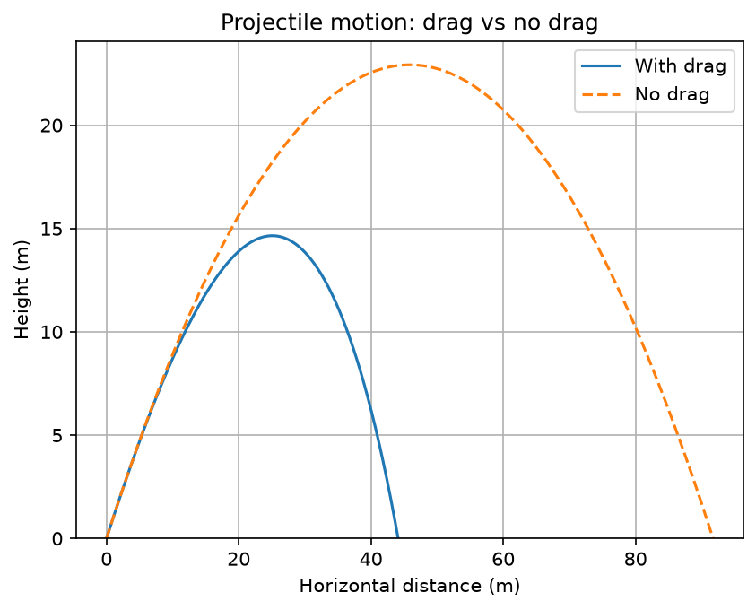

# Project log: Projectile Motion Model

###This model uses Eulers model of projectile motion to estimate an objects path of motion using small time intervals. The goal of this model was to compare the apogee and distance of identical projectiles with and without air resistance./

##Prerequisites and Requiremnets:/
###ProductName:		macOS
###ProductVersion:		26.6.2
###BuildVersion:		25G83
###Arcitecture:       arm64
###PythonVersion:        Python 3.13.14

## Roadmap / Status

**Status:** Work in progress (v0.2)

### Done
- [x] Basic script runs and produces output
- [x] Input loaded from a CSV file
- [x] Plot results with matplotlib

### In progress
- [ ] Compare the range of projectiles

### Known issues
- Crashes if the input file has blank rows

